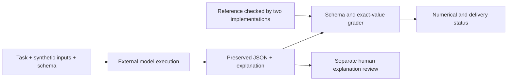

# Finance Workflow Bench

**Auditable financial tasks for evaluating AI-generated forecasts.** Six synthetic cases combine structured deliverables, exact monetary checks, reference calculations and separate explanation review.

The project tests whether an AI system can execute a specified financial workflow—not merely produce a plausible narrative. It separates **numerical correctness**, **delivery compliance** and **human assessment of the explanation**.

## Results at a glance

The four-case calibration battery contains eight received submissions, two per case. **All eight passed every numerical check. Two explanations exceeded the 800-word limit.** These are exploratory observations, not a general model ranking.

| Case | Financial mechanism | Checks per submission | GPT-labelled submission | Claude-labelled submission |
|---|---|---:|---|---|
| 003 | Staged rounding and half-cent interest | 126 | 100/100; 545 words | 100/100; **802 words** |
| 004 | Concentration across invoices of one customer | 140 | 100/100; 636 words | 100/100; 751 words |
| 005 | Fully paid mandatory cure with a cash-buffer breach | 128 | 100/100; 561 words | 100/100; 789 words |
| 006 | Zero collateral with enough cash to repay debt | 124 | 100/100; 559 words | 100/100; **801 words** |

The two over-length submissions retain their numerical scores but have `incomplete_submission` status. The others await human explanation review. No submission is represented as fully human-approved. Model labels are operator-reported; the Claude configuration did not establish the actual responding model's identity. Conditions and tool use were not uniformly verified.

[Results and limitations](docs/results.md) · [Detailed Portuguese report](reports/calibration-v1-final-pt.md) · [Raw run records](runs/)

## What to inspect

- **Financial specification:** [case 005](cases/bb_cure_005/task.md) distinguishes a paid debt obligation from adequate cash reserves.
- **Reference implementation:** [Decimal calculator](src/finance_workflow_bench/borrowing_base.py), checked against a [separate integer-cent implementation](scripts/verify_borrowing_base.py) using a net-position financing calculation.
- **Evaluator:** [calibration CLI](scripts/grade_calibration.py) selects operator-controlled references, validates output and compares exact monetary values.
- **Tests:** [calibration tests](tests/test_calibration.py) cover deliberate financial errors, wrong case IDs, changed reference hashes, invoice splitting, record order and package contents.
- **Evidence:** each run preserves submitted files, hashes, grader output, execution metadata and a separate preliminary AI explanation review.



## Reproduce locally

Python 3.10+; standard library only. No API key, model access, GPU or network connection is required for local checks. From the repository root:

```sh
python scripts/check.py
```

The latest local check passed **69 tests**, including complete reference cross-checks. Tests include deliberate incorrect submissions; these are not model results. The command refreshes local verification reports. Do not use Python's `-O` flag.

Try the evaluator on a known reference (a pipeline check, not a model run):

```sh
python scripts/grade_calibration.py bb_cure_005 reference/bb_cure_005 --report reports/my-demo.json
```

Expected: numerical score 100, `explanation_review_pending`, `overall_passed: false`. Use a new report filename every time. Exit code zero means evaluation completed, not overall approval.

For your own output, replace `reference/bb_cure_005` with a folder containing `forecast.json` and `analysis.md`. See [execution instructions](docs/calibration-v1-execution-pt.md) and [case-001 grading methodology](docs/grading.md); each case task states its own rubric.

## Case catalog

| Case | Scope | Evidence |
|---|---|---|
| cash_forecast_001 | 13-week cash forecast, partial settlements, duplicates, transfers, bounded revolver | [Task](cases/cash_forecast_001/task.md) |
| borrowing_base_002 | Eligibility, concentration, changing credit limits, unpaid mandatory cures | [Task](cases/borrowing_base_002/task.md) |
| bb_rounding_003 | Monetary rounding at different calculation stages | [Task](cases/bb_rounding_003/task.md) |
| bb_customer_004 | Invoice-to-customer aggregation before concentration | [Task](cases/bb_customer_004/task.md) |
| bb_cure_005 | Debt-limit compliance versus minimum-cash compliance | [Task](cases/bb_cure_005/task.md) |
| bb_release_006 | Empty snapshot with funded debt repayment | [Task](cases/bb_release_006/task.md) |

Four early manual pilots on cases 001–002 are retained separately from the eight calibration submissions. [Pilot summary](reports/manual-pilot-004-pt.md).

## Evaluation boundaries

Each agent ZIP includes exactly the task, instructions, schema and five inputs. References, tests and graders are excluded. Package separation is checked; process isolation in external model services is not established. Public reference answers make this a development benchmark, **not a held-out test set**.

References are selected by the operator, never by candidate-supplied paths. The calibration registry is trusted operator data and must be protected along with the evaluator. Hashes detect changed artifacts but are not a security boundary against someone who can also modify that registry.

There are no API integrations, automated model runner, validated RL reward or general model-performance claims. Individual field checks are correlated and must not be counted as independent statistical samples. The current cases did not distinguish the received outputs by numerical correctness.

## Authorship and provenance

Tobias Hopf selected the project direction and reviewed the financial rules and reference trajectories. Implementation, tests and documentation were developed with substantial AI assistance. The separate calculators provide computational cross-checking, not an independent human audit. Submitted explanations have preliminary AI reviews; formal human approval remains pending.

All business inputs are synthetic. [Data provenance](docs/data_provenance.md) · [Owner reference review](reference/calibration-v1-review-record.json).

This repository is prepared locally. No remote publication is implied by these files.